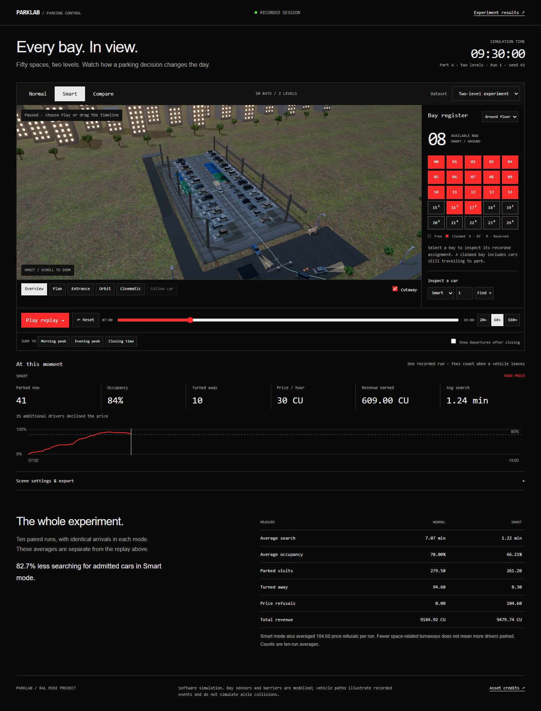

# ParkLab — Smart Parking Control

A redesigned interface for the RAL smart parking mini project, combining Taste Skill v2's **The quiet instrument** with **Tactical Telemetry & CRT Terminal** brutalism.

## Open the project

Run `Start ParkLab.bat`, then open http://127.0.0.1:8778. Or run `python -m http.server 8778 --bind 127.0.0.1` in this directory. The browser loads Three.js 0.160.0 from jsDelivr, so internet access is needed for the 3D library. Scene models, textures, logs and comparison data are included locally.

## Controls

- Select Normal, Smart or Compare to inspect the same recorded arrivals under different policies.
- Play/pause or scrub time; jump to morning, evening or closing. Enable after-hours departures to see remaining visits finish.
- Choose a ground or upper-floor bay in the register to inspect its assignment. Claimed includes travel before parking.
- Orbit/zoom the 3D view, use camera presets, inspect a car ID, or follow the selected car.
- Choose the original one-level or extended two-level dataset.
- Scene settings provide quality, day/sunset/night lighting, scene-image saving, photo mode and a recorded-data export.

## Data and scope

This is a software simulation, not a connected sensor deployment. The 3D display replays one exported run (seed 42). The comparison table averages ten paired runs (seeds 42–51). They are labelled separately. The extended Smart policy includes drivers who decline the price; lower space-related turnaways alone does not mean more cars parked.

The Python source and recorded results are unchanged from the original project. Verification hashes are in `verification.json`. Twenty extended-model simulations were rerun and reproduce the existing numerical comparison. Visual paths illustrate events and do not simulate aisle collisions.

To run the numerical model, install `requirements.txt` and run `parking_sim.py`. Its default reproduces the original model; set `LEGACY_MODE=False` for the extended model. `SHOW_CHARTS=False` saves charts without opening windows. Rerunning replaces generated result files, so keep the supplied logs if you want the exact recorded replay.

See `CREDITS.md` and `assets/licenses/` for asset attribution. `DESIGN.md` records the chosen direction and visual decisions.
